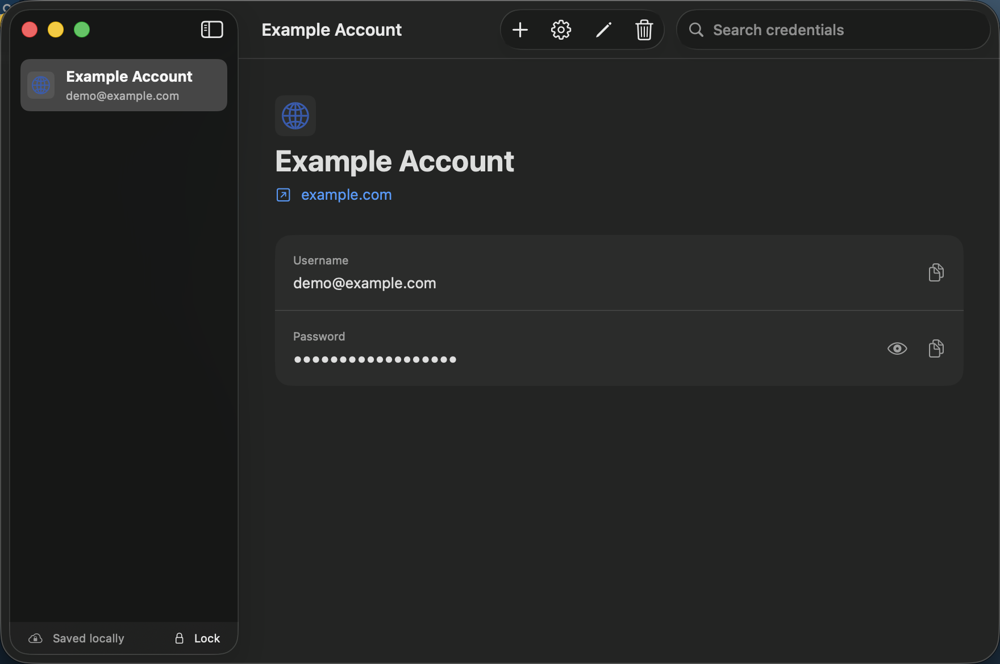
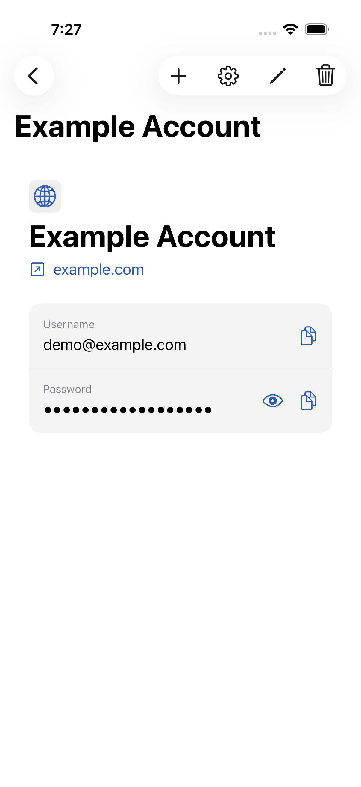

# PasswordManager

PasswordManager is an experimental SwiftUI password manager for macOS, iPhone, and iPad. It is a small reference implementation for encrypted local credential storage, private CloudKit sync, biometric quick unlock, and encrypted backups from one shared Apple-platform target.

> [!WARNING]
> This is a personal project, not independently audited security software. Do not use it as the only copy of high-value credentials. Keep an encrypted backup in a safe place: a lost master password cannot be recovered.

<p align="center">
  
</p>

<p align="center">
  
</p>

## Features

- AES-256-GCM encrypted vault with authenticated headers and fresh nonces.
- PBKDF2-HMAC-SHA256 master-password derivation with a 600,000-iteration baseline.
- Random 256-bit vault key wrapped by the master-password-derived key.
- Device-local Face ID or Touch ID quick unlock using the data-protection Keychain.
- Atomic encrypted local storage with a previous known-good copy.
- Optional private CloudKit synchronization of one opaque ciphertext blob, with change-tag conflict protection, credential/tombstone merging, and encrypted conflict preservation.
- Searchable SwiftUI credential management for websites, SSH connections, and API keys.
- Exact custom SSH command launch in Terminal on macOS, including jump hosts, tunnels, and other advanced options.
- Cryptographically secure 12–64 character password generator with editable per-site symbol sets.
- Password concealment, explicit copy, 30-second pasteboard clearing, background locking, a privacy cover, and encrypted backup export.

## Security model

The app generates a random vault key and uses it to encrypt the credential payload with AES-GCM. A key derived from the master password wraps that vault key. The encrypted envelope—not credential names, usernames, URLs, notes, or passwords—is written to local storage and, in the CloudKit configuration, the user's private CloudKit database.

Biometric quick unlock stores the random vault key in this device's data-protection Keychain, gated by the device's current biometric set. It does not store or recover the master password, and biometric access does not synchronize to another device.

See [PLAN.md](PLAN.md) for the historical implementation plan, cryptographic design, and threat-model notes. Passing tests demonstrate the behavior covered by those tests; they are not a substitute for an independent security review.

## Privacy and known limitations

- Website icons are fetched directly over HTTPS. This reveals the configured domain and the device's network address to that website when an icon is requested.
- Copied secrets are cleared after 30 seconds when still unchanged, but another application may read the pasteboard before then.
- Custom SSH commands are sent to Terminal exactly as saved. Terminal automation permission is required on macOS, and normal shell-history behavior applies.
- When enabled, CloudKit stores ciphertext in the signed-in user's private database, but Apple still processes account, record, and synchronization metadata.
- The app has no browser extension, Password AutoFill provider, credential sharing, or master-password recovery.
- CloudKit, Keychain, biometric, lifecycle-locking, and recovery behavior should be validated on physical devices before relying on them.

## Requirements

- Xcode 26.5 or newer.
- macOS 14 or newer for the Mac app.
- iOS or iPadOS 17 or newer for mobile devices.
- An Apple development team and a unique iCloud container only for CloudKit builds or installation on physical devices.
- Developer Mode and a valid provisioning profile for direct installation on an iPhone or iPad.

## Build and run

For the quickest start, open `PasswordManager.xcodeproj`, select the `PasswordManager` scheme, choose **My Mac** or an iPhone/iPad simulator, and press **Run**. This default configuration is local-only and needs no development team or CloudKit container.

| Scheme | Behavior |
| --- | --- |
| `PasswordManager` | Local encrypted vault; no CloudKit entitlement or connection |
| `PasswordManagerCloudKit` | Local encrypted vault plus private CloudKit synchronization |

The CloudKit scheme reads personal signing and container values from an ignored `Configuration/DeveloperSettings.xcconfig` file. See [CONFIGURATION.md](CONFIGURATION.md) for the local-only quick start, physical-device signing, complete CloudKit setup, command-line builds, switching behavior, and troubleshooting.

The project is intended for development or direct installation rather than App Store distribution. Public defaults contain no maintainer team, bundle, Keychain, backup-type, or CloudKit identifier.

## Verification

As of September 2, 2026:

- All 54 unit tests pass on macOS.
- Signed development builds succeed for macOS and generic iOS/iPadOS devices using the maintainer's local signing configuration.
- The app launches on macOS and iPhone/iPad simulators.
- An isolated iPhone UI test covers create, generate, save, edit, background lock, master-password unlock, and delete.
- An isolated macOS UI test creates a demo credential and captures the app window without using the installed vault.

Hardware- and account-dependent behavior still requires the checks in [DEVICE_VALIDATION.md](DEVICE_VALIDATION.md). Simulator tests do not prove Face ID/Touch ID, real CloudKit synchronization, device protection, or physical-device lifecycle behavior.

Run the macOS tests without code signing:

```sh
xcodebuild -project PasswordManager.xcodeproj \
  -scheme PasswordManager \
  -destination 'platform=macOS,arch=arm64' \
  CODE_SIGNING_ALLOWED=NO test
```

Compile an unsigned generic iOS build:

```sh
xcodebuild -project PasswordManager.xcodeproj \
  -scheme PasswordManager \
  -destination 'generic/platform=iOS' \
  CODE_SIGNING_ALLOWED=NO build
```

Run the isolated UI test after substituting an available simulator name:

```sh
xcodebuild -project PasswordManager.xcodeproj \
  -scheme PasswordManagerUI \
  -destination 'platform=iOS Simulator,name=iPhone 17' \
  test
```

Use `xcrun simctl list devices available` to list simulator destinations installed on the current Mac.

Run the isolated macOS screenshot test:

```sh
xcodebuild -project PasswordManager.xcodeproj \
  -scheme PasswordManagerUI \
  -destination 'platform=macOS,arch=arm64' \
  -only-testing:PasswordManagerUITests/PasswordManagerUITests/testMacOSCredentialDetailScreenshot \
  test
```

The full-resolution screenshot is saved as an attachment in the resulting `.xcresult` bundle.

## Data storage

Only the encoded encrypted vault envelope is persisted by the vault stores. Local files live in the app's Application Support container:

- `vault.pmvault` — current encrypted envelope.
- `vault.previous.pmvault` — previous known-good envelope.
- `Conflicts/*.pmvault` — encrypted CloudKit copies that could not be merged safely.
- `Conflicts/pending-cloud-conflict.pmvault` — encrypted unresolved remote copy used by the conflict-resolution screen.

Exported `.pmvault` backups use the same encrypted-envelope format. The app has no plaintext export, analytics, telemetry, remote application backend, or third-party package dependency.

## Project status

This remains a small personal MVP. Compatibility guarantees, migrations between arbitrary schema versions, security audits, and App Store support are outside its current scope.
